# FinTrack — Personal Financial Tracker
### Web Development and Design — Group Project Documentation

**Group members:** [Member 1 name, ID] · [Member 2 name, ID]
**Course / Section:** [Course code] **Submitted to:** [Teacher's name] **Date:** [Date]

---

## 1. Project Title and Overview

**FinTrack** is a web-based personal financial tracker. Users record their income and expenses, organise them into categories, set monthly budgets, save toward goals and see reports with charts.

The website is designed for two kinds of users:
- **Students**, who manage an allowance, tuition fees, part-time job income and hostel costs.
- **Professionals**, who manage a salary, rent, bills and long-term savings.

The user chooses a profile at registration. FinTrack then creates suitable starter categories, and its assistant **FinBot** gives advice that fits that profile.

FinBot is a rule-based "AI" assistant. It reads the user's own data from the MySQL database, calculates statistics (savings rate, spending trends, a month-end forecast), gives a financial health score and answers questions typed into a chat box.

**Technologies:** HTML5, CSS3, Bootstrap 5.3, Bootstrap Icons, JavaScript (Fetch API / AJAX), Chart.js, PHP 8, MySQL (MariaDB) on XAMPP, phpMyAdmin.

---

## 2. Main Features

**Required features**
1. **Multi-page Bootstrap website** with a consistent navbar, cards, responsive layout and mobile view.
2. **PHP + MySQL integration** through `mysqli` with prepared statements.
3. **CRUD operations** on four entities:
   - Transactions: add / list / edit / delete
   - Categories: add / list / edit / delete (in-use categories are protected)
   - Budgets: set / list / update / delete, plus copy from last month
   - Savings goals: create / list / edit / add money / delete
4. **JavaScript validation:** required fields, email format, min/max length, positive amounts, no future dates, password strength meter, "passwords match", categories filtered by Income/Expense, "From" date before "To" date. Every rule is checked again in PHP on the server.
5. **Search and reporting:**
   - Live AJAX search with filters by type, category, payment method and date range.
   - Reports page with date-range totals, charts, category breakdown, top expenses, CSV export and print to PDF.

**Additional features**
- Login / logout / registration with hashed passwords, plus a profile page (edit details, currency, change password).
- Dashboard with statistics, a 6-month bar chart, a category doughnut chart, budget and goal progress.
- **FinBot AI:** health score, smart insights, tip of the day, and a chat box on every page (AJAX).
- Charts (Chart.js), AJAX (live search and chat), CSV export, a print stylesheet, and toast/flash messages.
- Security: CSRF tokens, XSS escaping, SQL-injection-safe queries, and an ownership check on every query.

---

## 3. ER Diagram

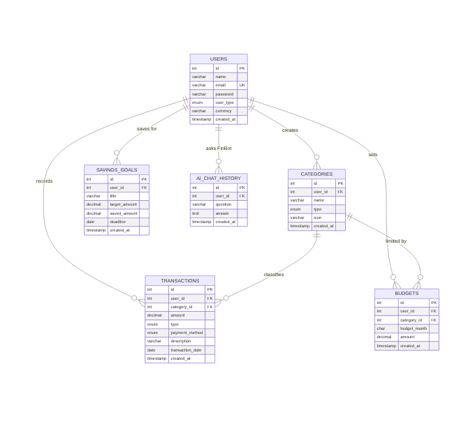

**Relationships**
- One **user** has many **categories**, **transactions**, **budgets**, **savings goals** and **chat messages** (1 : N).
- One **category** has many **transactions** and many **budgets** (1 : N).
- Deleting a user deletes all their data (`ON DELETE CASCADE`).
- A category that is used by transactions **cannot be deleted** (`ON DELETE RESTRICT`).
- A user can have only one budget per category per month (`UNIQUE (user_id, category_id, budget_month)`).

---

## 4. Data Dictionary

### users
| Field | Type | Key / Constraint | Description |
|---|---|---|---|
| id | INT UNSIGNED | PK, AUTO_INCREMENT | Unique user ID |
| name | VARCHAR(100) | NOT NULL | Full name |
| email | VARCHAR(150) | UNIQUE, NOT NULL | Login email |
| password | VARCHAR(255) | NOT NULL | Password hash (`password_hash`) |
| user_type | ENUM('student','professional') | DEFAULT 'student' | Profile type, used for default categories and advice |
| currency | VARCHAR(5) | DEFAULT '৳' | Currency symbol shown in the app |
| created_at | TIMESTAMP | DEFAULT CURRENT_TIMESTAMP | Registration time |

### categories
| Field | Type | Key / Constraint | Description |
|---|---|---|---|
| id | INT UNSIGNED | PK | Category ID |
| user_id | INT UNSIGNED | FK → users.id (CASCADE) | Owner |
| name | VARCHAR(100) | NOT NULL, UNIQUE with user_id + type | Category name |
| type | ENUM('income','expense') | NOT NULL | Income or expense category |
| icon | VARCHAR(40) | DEFAULT 'bi-tag' | Bootstrap icon class |
| created_at | TIMESTAMP | | Creation time |

### transactions
| Field | Type | Key / Constraint | Description |
|---|---|---|---|
| id | INT UNSIGNED | PK | Transaction ID |
| user_id | INT UNSIGNED | FK → users.id (CASCADE) | Owner |
| category_id | INT UNSIGNED | FK → categories.id (RESTRICT) | Category |
| amount | DECIMAL(12,2) | NOT NULL, CHECK > 0 | Amount of money |
| type | ENUM('income','expense') | NOT NULL | Income or expense |
| payment_method | ENUM('cash','card','mobile_banking','bank') | DEFAULT 'cash' | How it was paid |
| description | VARCHAR(255) | NULL | Optional note |
| transaction_date | DATE | NOT NULL, INDEX | Date of the transaction |
| created_at | TIMESTAMP | | Record creation time |

### budgets
| Field | Type | Key / Constraint | Description |
|---|---|---|---|
| id | INT UNSIGNED | PK | Budget ID |
| user_id | INT UNSIGNED | FK → users.id (CASCADE) | Owner |
| category_id | INT UNSIGNED | FK → categories.id (CASCADE) | Expense category |
| budget_month | CHAR(7) | UNIQUE with user + category | Month in format YYYY-MM |
| amount | DECIMAL(12,2) | CHECK > 0 | Monthly spending limit |
| created_at | TIMESTAMP | | Creation time |

### savings_goals
| Field | Type | Key / Constraint | Description |
|---|---|---|---|
| id | INT UNSIGNED | PK | Goal ID |
| user_id | INT UNSIGNED | FK → users.id (CASCADE) | Owner |
| title | VARCHAR(100) | NOT NULL | What the user is saving for |
| target_amount | DECIMAL(12,2) | CHECK > 0 | Goal amount |
| saved_amount | DECIMAL(12,2) | DEFAULT 0, CHECK >= 0 | Amount saved so far |
| deadline | DATE | NULL | Optional target date |
| created_at | TIMESTAMP | | Creation time |

### ai_chat_history
| Field | Type | Key / Constraint | Description |
|---|---|---|---|
| id | INT UNSIGNED | PK | Message ID |
| user_id | INT UNSIGNED | FK → users.id (CASCADE) | Who asked |
| question | VARCHAR(500) | NOT NULL | Question typed by the user |
| answer | TEXT | NOT NULL | FinBot's answer |
| created_at | TIMESTAMP | | Time of the question |

---

## 5. Important SQL / Table Creation Code

The full script is in `database/financial_tracker.sql`. Key parts:

```sql
CREATE TABLE transactions (
    id                INT UNSIGNED AUTO_INCREMENT PRIMARY KEY,
    user_id           INT UNSIGNED NOT NULL,
    category_id       INT UNSIGNED NOT NULL,
    amount            DECIMAL(12,2) NOT NULL,
    type              ENUM('income','expense') NOT NULL,
    payment_method    ENUM('cash','card','mobile_banking','bank') NOT NULL DEFAULT 'cash',
    description       VARCHAR(255) NULL,
    transaction_date  DATE NOT NULL,
    created_at        TIMESTAMP DEFAULT CURRENT_TIMESTAMP,
    CONSTRAINT fk_transactions_user
        FOREIGN KEY (user_id) REFERENCES users(id) ON DELETE CASCADE ON UPDATE CASCADE,
    CONSTRAINT fk_transactions_category
        FOREIGN KEY (category_id) REFERENCES categories(id) ON DELETE RESTRICT ON UPDATE CASCADE,
    CONSTRAINT chk_transaction_amount CHECK (amount > 0)
);

CREATE TABLE budgets (
    id            INT UNSIGNED AUTO_INCREMENT PRIMARY KEY,
    user_id       INT UNSIGNED NOT NULL,
    category_id   INT UNSIGNED NOT NULL,
    budget_month  CHAR(7) NOT NULL,
    amount        DECIMAL(12,2) NOT NULL,
    FOREIGN KEY (user_id) REFERENCES users(id) ON DELETE CASCADE,
    FOREIGN KEY (category_id) REFERENCES categories(id) ON DELETE CASCADE,
    CONSTRAINT uq_budget UNIQUE (user_id, category_id, budget_month)
);
```

**Important queries used in the app**

```sql
-- Create (add_transaction.php)
INSERT INTO transactions (user_id, category_id, amount, type, payment_method, description, transaction_date)
VALUES (?, ?, ?, ?, ?, ?, ?);

-- Update (edit_transaction.php) – "AND user_id = ?" stops users editing other people's data
UPDATE transactions SET category_id = ?, amount = ?, type = ?, payment_method = ?, description = ?, transaction_date = ?
WHERE id = ? AND user_id = ?;

-- Delete (delete_transaction.php)
DELETE FROM transactions WHERE id = ? AND user_id = ?;

-- Search / filter (transactions.php) – built dynamically
SELECT t.*, c.name AS category_name FROM transactions t
JOIN categories c ON c.id = t.category_id
WHERE t.user_id = ? AND (t.description LIKE ? OR c.name LIKE ?) AND t.type = ? AND t.transaction_date >= ?
ORDER BY t.transaction_date DESC;

-- Report: spending per category (reports.php)
SELECT c.name, t.type, SUM(t.amount) AS total, COUNT(*) AS cnt
FROM transactions t JOIN categories c ON c.id = t.category_id
WHERE t.user_id = ? AND t.transaction_date BETWEEN ? AND ?
GROUP BY c.id, c.name, t.type ORDER BY total DESC;

-- Budget: insert or update in one query (budgets.php)
INSERT INTO budgets (user_id, category_id, budget_month, amount) VALUES (?, ?, ?, ?)
ON DUPLICATE KEY UPDATE amount = VALUES(amount);
```

---

## 6. Screenshots

| # | Page | File |
|---|---|---|
| 1 | Login | 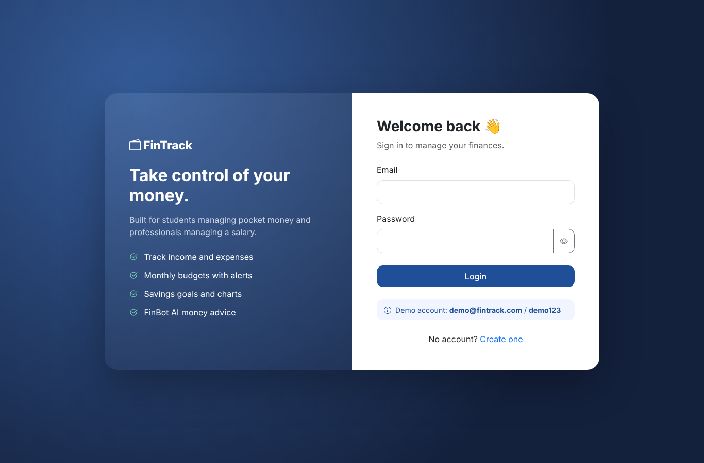 |
| 2 | Registration (with validation) | 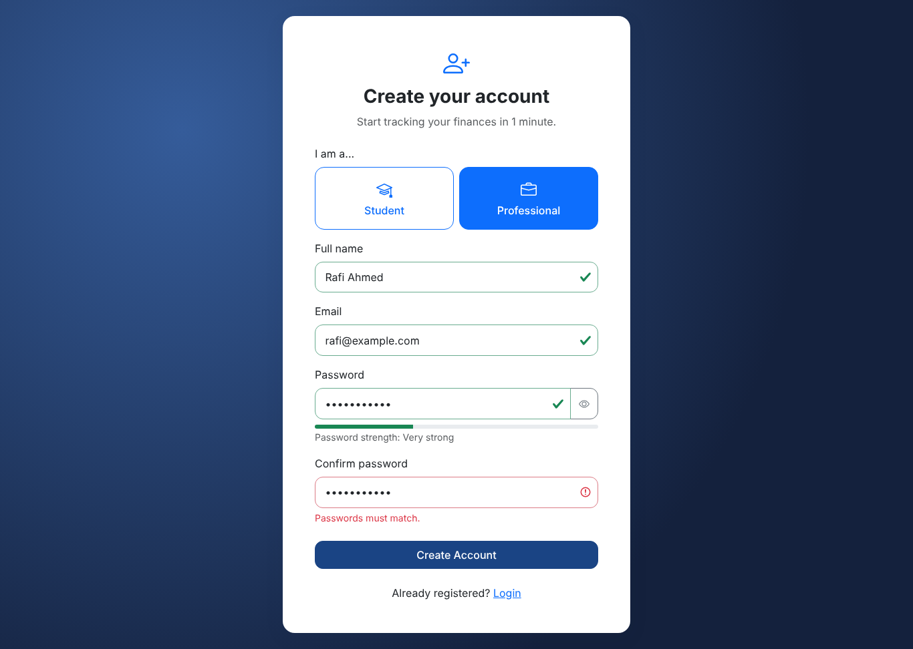 |
| 3 | Dashboard | 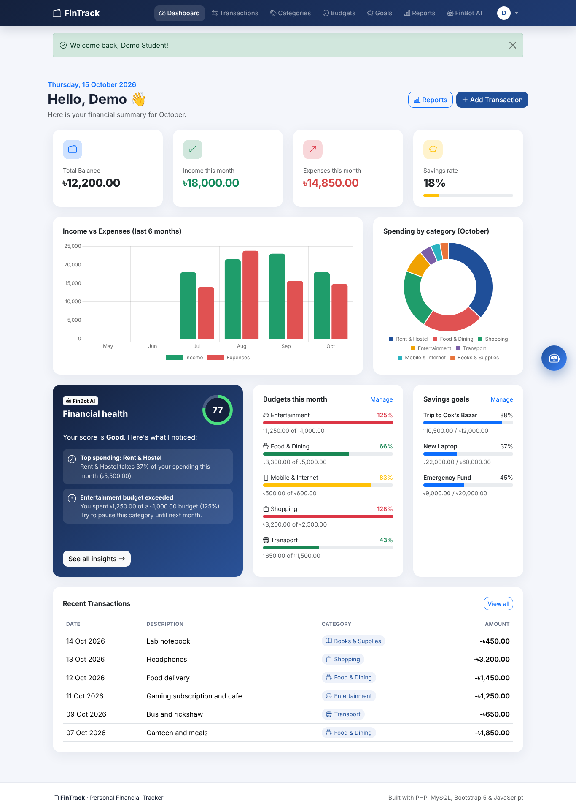 |
| 4 | Add transaction | 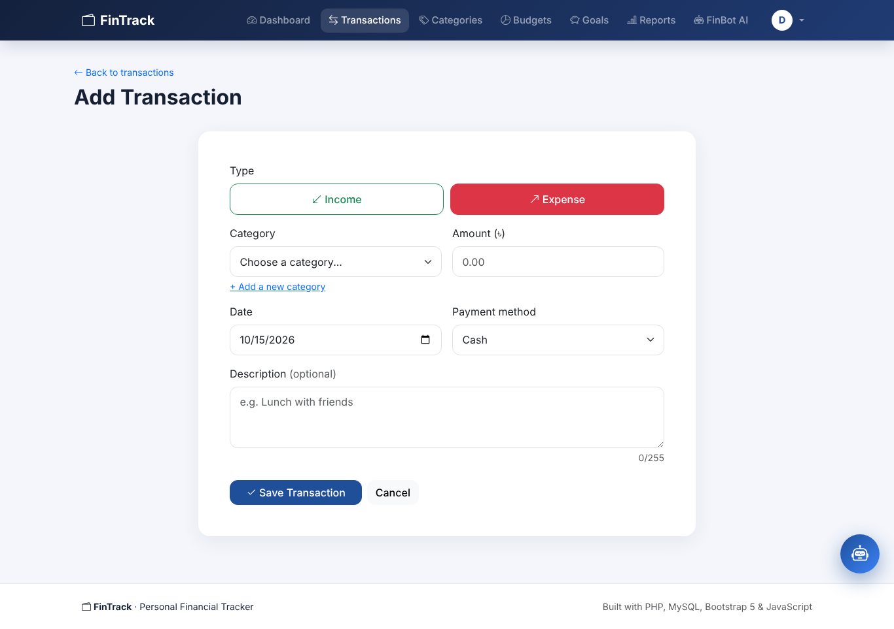 |
| 5 | Transaction list | 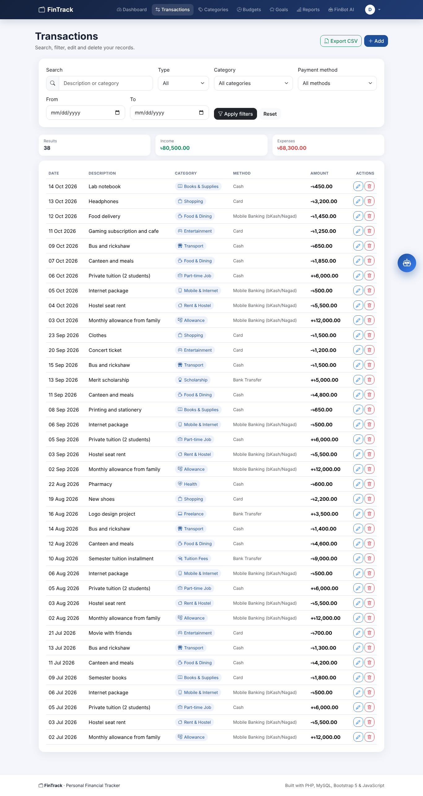 |
| 6 | Delete confirmation | 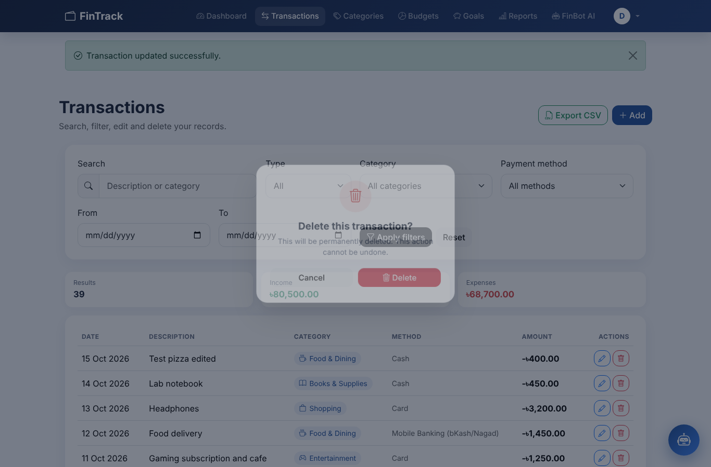 |
| 7 | Live search / filter | 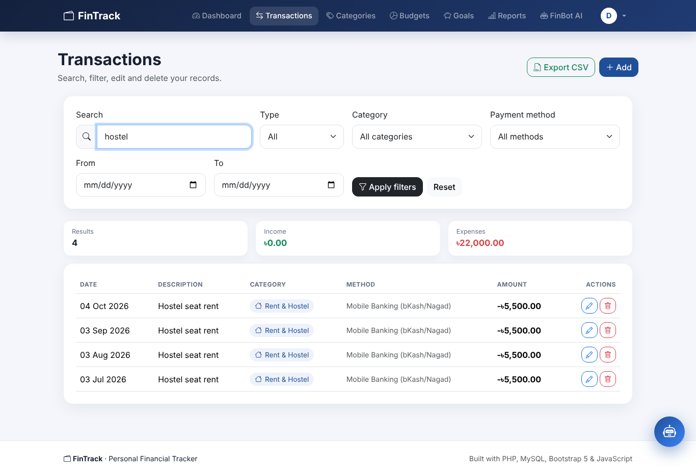 |
| 8 | Categories | 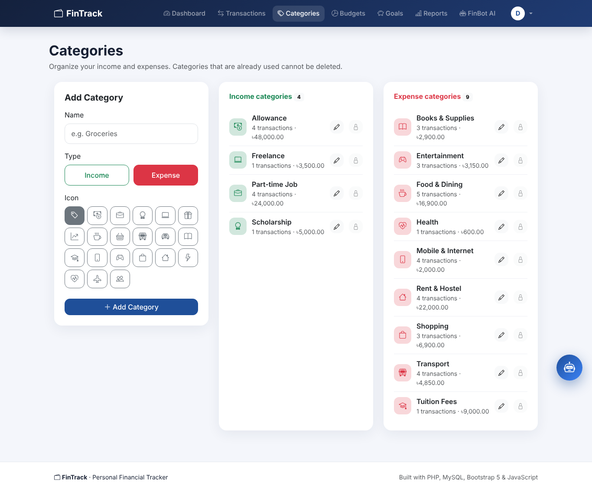 |
| 9 | Budgets | 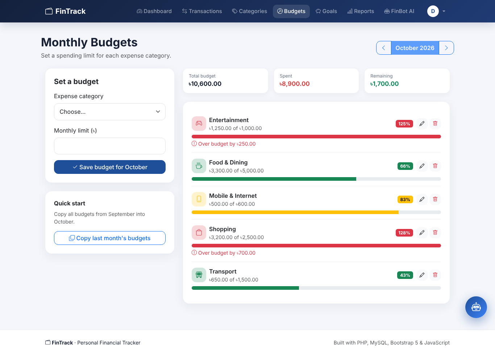 |
| 10 | Savings goals | 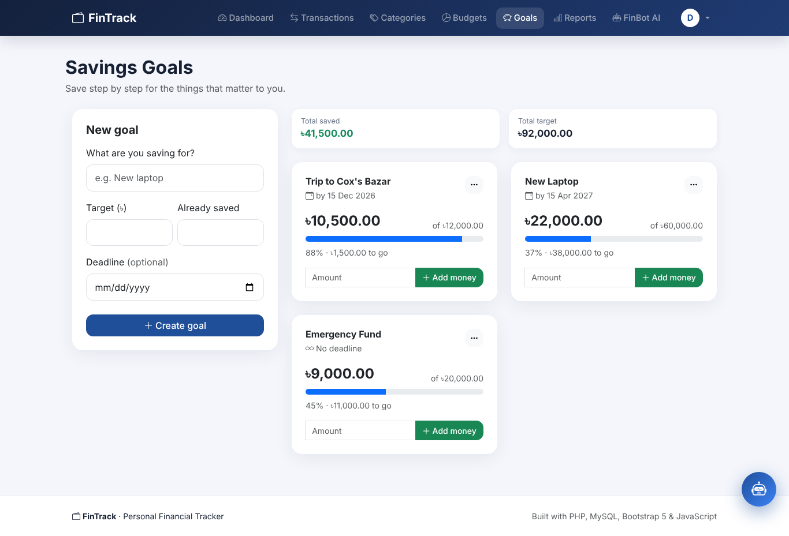 |
| 11 | Reports | 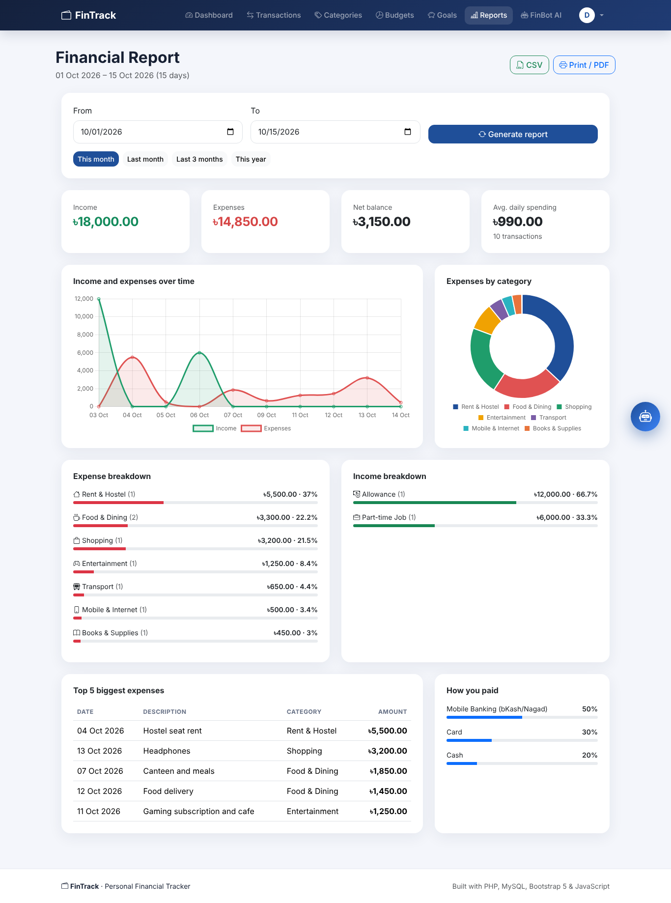 |
| 12 | FinBot AI page | 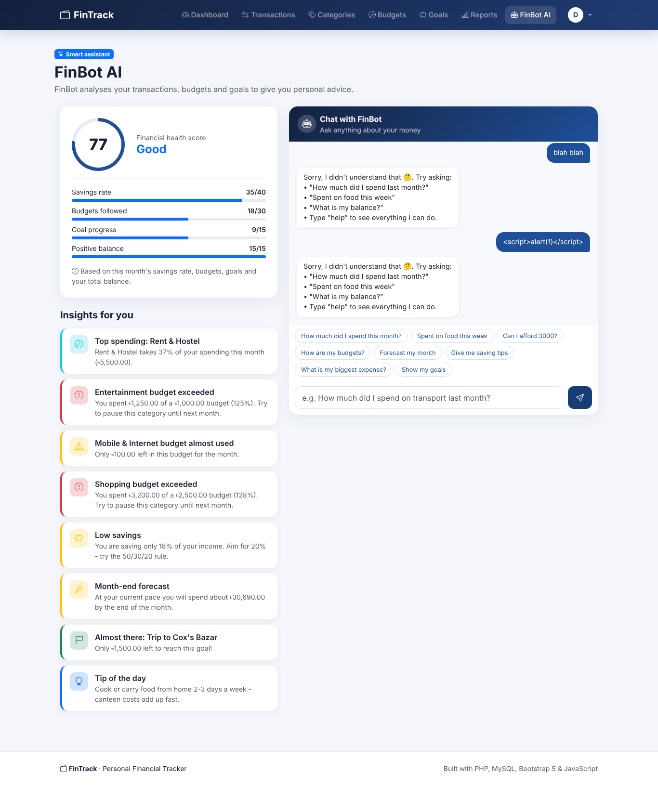 |
| 13 | FinBot chat box | 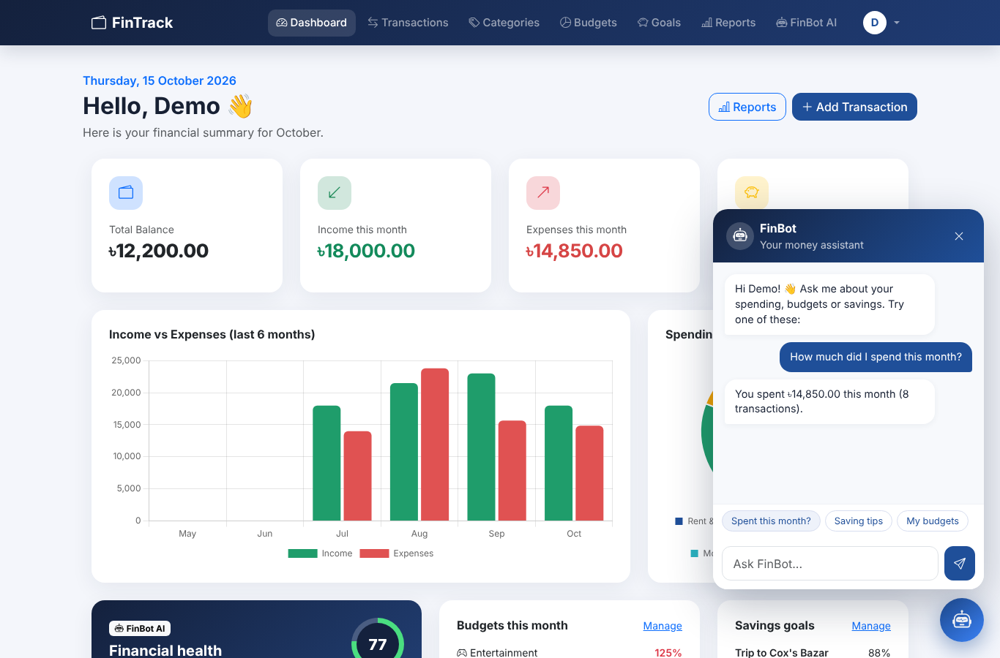 |
| 14 | Profile | 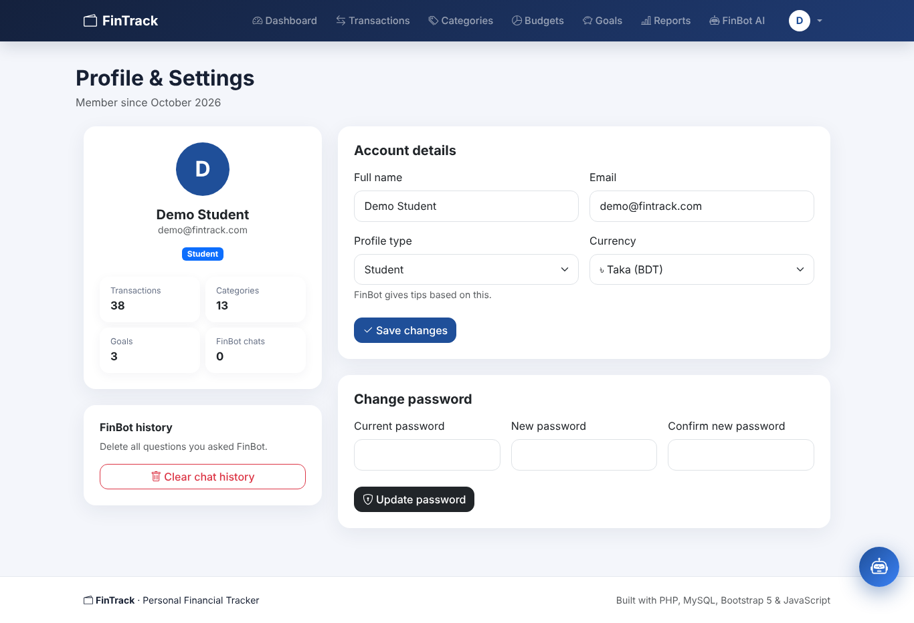 |
| 15 | Mobile view | 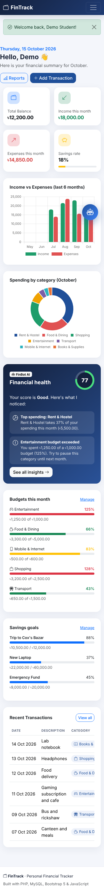 |
| 16 | phpMyAdmin tables | *(add your own screenshot from phpMyAdmin)* |

---

## 7. Group Contribution

| Member | Contribution |
|---|---|
| **[Member 1 name]** | Database design (ER diagram, 6 tables, keys, constraints, demo data), PHP–MySQL connection, authentication (register / login / logout / profile / password hashing / CSRF), Transaction CRUD, Category CRUD, Budgets, server-side validation, FinBot logic (`ai_helper.php`: insights, health score, chat answers) |
| **[Member 2 name]** | Bootstrap UI and page layouts, CSS design and responsive / mobile layout, JavaScript validation (password strength, matching, type-based category filter, date checks), AJAX live search and chat box, Chart.js charts (dashboard and reports), Reports page, Savings goals page, CSV export and print view, testing, screenshots and documentation |

*Both members understand the complete application and can explain any part of it.*

---

## 8. Video Demonstration Plan (3–5 minutes)

| Time | What to show |
|---|---|
| 0:00–0:30 | Project title, XAMPP running, phpMyAdmin with the 6 tables |
| 0:30–1:00 | Register a new user (show JS validation: wrong email, short password, passwords don't match), then log in |
| 1:00–2:00 | **CRUD:** add a transaction, show it in the list **and in phpMyAdmin**, edit it, delete it (confirmation popup) |
| 2:00–2:30 | Live search and filters, CSV export |
| 2:30–3:15 | Categories, budgets (progress bars), savings goals (add money) |
| 3:15–4:00 | Reports with charts, FinBot health score and chat ("Can I afford 3000?", "spent on food this month") |
| 4:00–5:00 | Code: `config/database.php`, a prepared statement in `add_transaction.php`, `validateTransaction()`, `script.js` validation, `ai_helper.php` rules |
